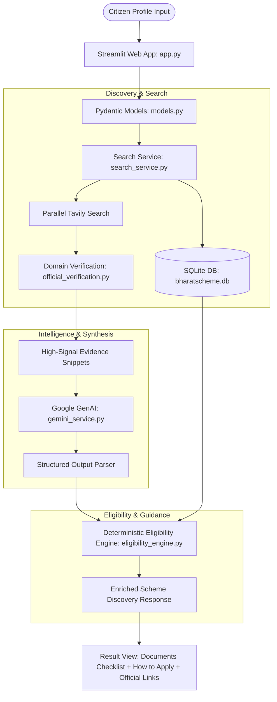

# 🇮🇳 BharatScheme AI

> **"Find Your Benefits. Know Your Eligibility. Apply with Confidence."**

An intelligent, AI-powered citizen guidance platform designed to help every Indian discover relevant Central and State Government welfare schemes, understand precise eligibility criteria, prepare required documents, and access genuine official application portals.

---

## Table of Contents

1. [Project Introduction](#1-project-introduction)
2. [Problem Statement](#2-problem-statement)
3. [Objectives](#3-objectives)
4. [Key Features](#4-key-features)
5. [User Interface Overview](#5-user-interface-overview)
6. [Technology Stack](#6-technology-stack)
7. [System Architecture](#7-system-architecture)
8. [Module-by-Module Explanation](#8-module-by-module-explanation)
9. [Project Directory Structure](#9-project-directory-structure)
10. [High-Speed Search Workflow](#10-high-speed-search-workflow)
11. [AI Analysis Workflow](#11-ai-analysis-workflow)
12. [Deterministic Eligibility Matching](#12-deterministic-eligibility-matching)
13. [Required Document Extraction & Checklist](#13-required-document-extraction--checklist)
14. [Step-by-Step How to Apply Guidance](#14-step-by-step-how-to-apply-guidance)
15. [Direct Official Portal Link Verification](#15-direct-official-portal-link-verification)
16. [SQLite Database Architecture](#16-sqlite-database-architecture)
17. [Prerequisites & Requirements](#17-prerequisites--requirements)
18. [Installation Guide](#18-installation-guide)
19. [Virtual Environment Setup](#19-virtual-environment-setup)
20. [API Key Configuration](#20-api-key-configuration)
21. [Local Execution](#21-local-execution)
22. [Automated Testing](#22-automated-testing)
23. [GitHub Upload Instructions](#23-github-upload-instructions)
24. [Streamlit Community Cloud Deployment](#24-streamlit-community-cloud-deployment)
25. [Troubleshooting Guide](#25-troubleshooting-guide)
26. [System Limitations](#26-system-limitations)
27. [Privacy & Security Commitment](#27-privacy--security-commitment)
28. [Future Enhancements](#28-future-enhancements)
29. [Official Disclaimer](#29-official-disclaimer)

---

## 1. Project Introduction

**BharatScheme AI** simplifies government scheme discovery for Indian citizens. With hundreds of welfare initiatives across Central and State Governments (such as PM-KISAN, Ayushman Bharat PM-JAY, National Scholarship Portal, PMAY, PM Mudra Yojana, Atal Pension Yojana, Pudhumai Penn, and Stand-Up India), citizens often face fragmented information, unverified third-party blogs, confusing eligibility guidelines, and broken links.

BharatScheme AI bridges this gap with an evidence-grounded search engine, deterministic eligibility evaluation, verified document checklists, and direct links to official government portals.

---

## 2. Problem Statement

* **Information Fragmentation:** Schemes are scattered across hundreds of ministry portals and state department websites.
* **Misleading Third-Party Content:** Citizens searching for schemes frequently land on ad-heavy private blogs presenting outdated or inaccurate requirements.
* **Unclear Eligibility Rules:** Many applicants struggle to determine whether age, income, caste, state residency, or landholding rules apply to them.
* **Missing Application Procedures:** Citizens often learn about a scheme but fail to find the exact step-by-step procedure or where to submit the form.
* **Unverified Links:** Fake portals, phishing links, or general ministry homepages often confuse applicants looking for actual registration forms.

---

## 3. Objectives

* Provide **instant discovery** of relevant Central and State Government schemes.
* Perform **fast AI synthesis** using Google Gemini without hallucinating fake benefits or URLs.
* Accurately evaluate **four eligibility tiers** (`Eligible`, `Possibly Eligible`, `Not Eligible`, `Insufficient Information`).
* Present a practical **Required Documents Checklist** (identifying mandatory vs. optional documents).
* Provide **scheme-specific step-by-step application instructions**.
* Deliver verified **direct official application portal links** labeled clearly.
* Guarantee **zero privacy intrusion** (never collecting Aadhaar numbers, bank account numbers, passwords, or OTPs).

---

## 4. Key Features

* **Interactive Multi-Select Support Categories:** 15 distinct support categories (Scholarships, Business Loans, Farmer Welfare, Women Empowerment, Housing, Healthcare, etc.) with selectable visual cards and icons.
* **Targeted Profile Intake:** Simple citizen inputs (Age, Gender, State, Income, Occupation, Student/Farmer status) with zero sensitive data collection.
* **Hybrid Parallel Search Engine:** Combines an instant local SQLite verified catalogue with concurrent Tavily web discovery, executing in 2–3 seconds.
* **Deterministic Eligibility Engine:** High-precision Python rule evaluation for age thresholds, income ceilings, gender prerequisites, and state residency.
* **Verified Document Checklist:** Checklist format highlighting mandatory vs. optional documents and their verification purposes.
* **Step-by-Step How to Apply Section:** Concrete instructions from portal registration and form filling to document upload and reference tracking.
* **Direct Official Portal Verification:** Domain validation (`.gov.in`, `.nic.in`, `scholarships.gov.in`, `pmkisan.gov.in`, `jansamarth.in`) distinguishing actual application forms from general information pages.
* **Multi-Language UI Support:** Supports English, Tamil, Hindi, Telugu, Malayalam, Kannada, Bengali, Marathi, Gujarati, Punjabi, and Urdu.
* **Resilient Offline Fallback:** If Gemini API or web search encounters quota limits or network interruptions, verified local database schemes are served seamlessly.

---

## 5. User Interface Overview

* **Indian Tricolour Theme:** Saffron (`#FF9933`), White (`#FFFFFF`), Green (`#138808`), and Deep Navy (`#142B4A`) with Ashoka Chakra-inspired accents.
* **Landing Page:** Hero banner, category showcase, step-by-step workflow overview, and quick-start actions.
* **"What Support Do You Need?" Section:** Responsive card grid with 15 categories, real-time selection summary, and an optional custom request field.
* **Scheme Result Cards:** Expandable cards featuring level badges, match status icons, benefits overview, eligibility explanations, interactive document checklists, application steps, and a prominent **"APPLY NOW – OFFICIAL PORTAL"** button.

---

## 6. Technology Stack

| Layer | Component | Description |
|---|---|---|
| **Frontend UI** | Streamlit 1.67+ | Python-native web application with custom CSS |
| **Language Models** | Google GenAI SDK | `gemini-3.1-flash-lite` / `gemini-3.8-flash` |
| **Search Engine** | Tavily Python SDK | Multi-threaded parallel official domain search |
| **Data Validation** | Pydantic v2 | Strict JSON schema parsing and data models |
| **Database** | SQLite3 | Local storage of verified schemes and raw documents |
| **HTML / Text Parsing**| Trafilatura & BeautifulSoup4 | Robust web page content extraction |
| **Runtime** | Python 3.11+ | Multi-threaded async/concurrent execution |

---

## 7. System Architecture



---

## 8. Module-by-Module Explanation

* **[app.py](file:///D:/BharatSchemeAI/app.py):** Main Streamlit application controlling routing, landing page, profile intake, "What Support Do You Need?" multi-select cards, and scheme results presentation.
* **[models.py](file:///D:/BharatSchemeAI/models.py):** Pydantic data schemas defining `UserProfile`, `GovernmentScheme`, `DocumentRequirement`, `ApplicationProcedure`, `ApplicationStep`, `EligibilityResult`, and `MatchStatus`.
* **[config.py](file:///D:/BharatSchemeAI/config.py):** Environment configuration supporting dual-resolution from local `.env` and Streamlit Cloud `st.secrets`.
* **[curated_data.py](file:///D:/BharatSchemeAI/curated_data.py):** Pre-seeded verified database containing 16 comprehensive Central and State Government schemes with verified document checklists and official application portals.
* **[scheme_catalogue.py](file:///D:/BharatSchemeAI/scheme_catalogue.py):** SQLite database interface managing `verified_schemes` and `scheme_documents` tables with search indexes.
* **[search_service.py](file:///D:/BharatSchemeAI/search_service.py):** High-speed search coordinator running local SQLite catalogue matching and multi-threaded parallel Tavily search queries with in-memory TTL caching.
* **[gemini_service.py](file:///D:/BharatSchemeAI/gemini_service.py):** Gemini AI client managing prompt distillation, structured JSON schema validation, cache handling, and local fallback.
* **[eligibility_engine.py](file:///D:/BharatSchemeAI/eligibility_engine.py):** Pure Python rule engine evaluating age, gender, state residency, income ceilings, occupation, and disability status.
* **[official_verification.py](file:///D:/BharatSchemeAI/official_verification.py):** Domain provenance analyzer classifying URLs into Direct Application Portals, Official Information Pages, Secondary Sources, or Unverified links.
* **[source_registry.py](file:///D:/BharatSchemeAI/source_registry.py):** Directory of recognized Central and State Government portals.
* **[translations.py](file:///D:/BharatSchemeAI/translations.py):** Multilingual dictionary covering 11 Indian languages.
* **[landing.py](file:///D:/BharatSchemeAI/landing.py):** Presentation layer for the Indian Tricolour landing page.
* **[scheme_browser.py](file:///D:/BharatSchemeAI/scheme_browser.py):** Catalog exploration page for browsing all stored schemes without profile submission.
* **[assets/style.css](file:///D:/BharatSchemeAI/assets/style.css):** Custom CSS styling supporting responsive layouts, Tricolour buttons, and card selection states.

---

## 9. Project Directory Structure

```text
D:\BharatSchemeAI\
├── .env                          # Local private API keys (git-ignored)
├── .env.example                  # Template for environment configuration
├── .gitignore                    # Prevents secrets and virtual environments from tracking
├── .streamlit/
│   └── config.toml               # Streamlit server and tricolour theme configuration
├── app.py                        # Main entry point for the Streamlit web application
├── assets/
│   ├── style.css                 # Custom styling, tricolour accents, selectable cards
│   └── images/                   # Visual branding assets
├── collection_pipeline.py        # Web crawler & collector pipeline script
├── config.py                     # Secret resolution (local .env + st.secrets)
├── curated_data.py               # Pre-seeded verified government schemes data
├── database/
│   └── bharatscheme.db           # SQLite database holding verified and raw schemes
├── eligibility_engine.py         # Deterministic rule-based eligibility evaluation engine
├── gemini_service.py             # Google GenAI prompt engineering and analysis logic
├── landing.py                    # Tricolour landing page UI component
├── models.py                     # Pydantic data models and enums
├── official_verification.py      # Official government domain & portal URL validator
├── README.md                     # Comprehensive project documentation
├── requirements.txt              # Production Python package dependencies
├── scheme_browser.py             # Public catalogue browser interface
├── scheme_catalogue.py           # SQLite database operations & queries
├── scheme_collector.py           # HTML and PDF document text extractor
├── search_service.py             # High-speed hybrid search with multi-threading
├── source_discovery.py           # Web link discovery & robots.txt checker
├── source_registry.py            # Registry of official government domains
├── translations.py               # Multilingual translations (11 languages)
└── venv/                         # Local Python virtual environment (git-ignored)
```

---

## 10. High-Speed Search Workflow

1. **Profile Synthesis:** The user submits their demographic details, selected support categories, and optional description.
2. **Local SQLite First:** The local verified catalogue is queried immediately. Matching verified schemes are retrieved in under 5 milliseconds.
3. **Focused Query Generation:** Rather than running 15 generic queries, the search builder generates 2–3 high-precision queries combining state, selected support categories, and official portal keywords.
4. **Parallel Web Discovery:** Queries are executed concurrently using `ThreadPoolExecutor`, reducing Tavily latency from 30+ seconds down to 2–3 seconds.
5. **URL Normalization & Deduplication:** Redundant URLs are pruned while retaining the richest text content snippet.
6. **In-Memory TTL Cache:** Search queries are cached for 1 hour to prevent duplicate network hits.

---

## 11. AI Analysis Workflow

1. **Evidence Condensation:** Raw content is trimmed into compact snippets (<1,200 characters each), reducing token payload by 80%.
2. **Single-Request Prompting:** High-signal evidence is bundled into a single batch request using `response_schema=SchemeDiscoveryResponse` and `response_mime_type="application/json"`.
3. **Active Model Selection:** Default model configured to `gemini-3.1-flash-lite` for high speed, with automatic fallback support.
4. **Hallucination Protection:** The system instruction strictly prohibits generating fake benefits, invented application steps, or fabricated URLs.
5. **Verified Catalogue Enrichment:** AI output is cross-referenced with SQLite verified schemes to attach complete document checklists and genuine application portals.

---

## 12. Deterministic Eligibility Matching

Every scheme undergoes rule-based verification across:

* **State Residency:** Rejects state-specific schemes when the applicant's residence does not match.
* **Gender Criteria:** Enforces female-only requirements for schemes like *Kalaignar Magalir Urimai Thittam*, *Pudhumai Penn*, and *PMMVY*.
* **Age Limits:** Validates strict thresholds (e.g., 18–40 years for *Atal Pension Yojana*, 21+ for *KMUT*, 18+ for *PM-KISAN*).
* **Income Ceilings:** Compares annual family income against specified limits (e.g., ₹2.5 Lakh for scholarships and basic income schemes).
* **Role Alignment:** Verifies farmer, student, artisan, street vendor, or disability declarations.

### Four Match Status Tiers:
* 🟢 **Eligible:** All verified criteria match with high confidence.
* 🟡 **Possibly Eligible:** Primary criteria match; specific documents or revenue certificates require physical validation.
* 🔴 **Not Eligible:** One or more hard criteria (age, gender, state residency, income threshold) are violated.
* ⚪ **Insufficient Information:** Critical details are missing to make a definitive determination.

---

## 13. Required Document Extraction & Checklist

For every discovered scheme, documents are presented in an interactive checklist:

* **Mandatory Documents (🔴):** Crucial proofs required for application acceptance (e.g., Aadhaar card for DBT linkage, Patta/Khatauni for PM-KISAN, College Bonafide for NSP).
* **Optional / Supporting Documents (🟡):** Documents required only under specific conditions (e.g., Caste Certificate for reserved categories, Machinery Quotation for Mudra Tarun loans).
* **Document Purpose:** Every document includes a clear explanation of *why* it is required.

---

## 14. Step-by-Step How to Apply Guidance

Each scheme provides explicit, verified application guidance:

* **Application Mode:** Clearly labels whether the scheme is **Online**, **Offline**, or **Hybrid**.
* **Numbered Sequence:** Step 1 through Step N detailing portal navigation, OTP registration, form sections, document attachment, and final submission.
* **Physical Offices:** For offline/hybrid schemes, specifies the exact designated authority (e.g., Common Service Centres, Village Administrative Office, Tahsildar, District Social Welfare Office).
* **Tracking Method:** Instructions on tracking status using the generated Application Reference ID.

---

## 15. Direct Official Portal Link Verification

Links are classified into four distinct trust levels:

1. **Direct Application Portal:** Verified official endpoints leading directly to registration, login, or online forms (e.g., `https://pmkisan.gov.in/RegistrationFormNew.aspx`, `https://scholarships.gov.in/applicant-login`). Rendered with a prominent **"APPLY NOW – OFFICIAL PORTAL"** button.
2. **Official Scheme Information Page:** Genuine government portal guidelines and notification pages on `.gov.in` / `.nic.in`.
3. **Secondary Informational Source:** Reputable external portals used solely for discovery.
4. **Unverified Link:** Flagged clearly; never labeled as an official application form.

---

## 16. SQLite Database Architecture

Database file located at `database/bharatscheme.db`:

### Table: `verified_schemes`
Stores structured, verified scheme records with full document checklists and official portal links.
* **Columns:** `id`, `name`, `aliases_json`, `ministry`, `department`, `description`, `benefits`, `eligibility_criteria`, `category`, `level`, `state`, `district`, `documents_required_json`, `required_documents_json`, `application_steps_json`, `how_to_apply`, `application_procedure_json`, `official_link`, `application_link`, `has_direct_form`, `link_type`, `is_application_link_verified`, `source`, `source_urls_json`, `verification_status`, `last_checked`.
* **Indexes:** `idx_verified_name`, `idx_verified_category`, `idx_verified_state`, `idx_verified_level`.

### Table: `scheme_documents`
Stores raw web documents harvested from government domains.
* **Columns:** `id`, `title`, `url`, `parent_url`, `source_name`, `source_type`, `level`, `state`, `content_type`, `content`, `extraction_status`, `discovery_status`, `first_collected`, `last_collected`.

---

## 17. Prerequisites & Requirements

* **Operating System:** Windows 10/11, macOS, or Linux.
* **Python Version:** Python 3.11 or higher.
* **Free API Keys:**
  * **Google Gemini API Key:** [Google AI Studio](https://aistudio.google.com/apikey)
  * **Tavily Search API Key:** [Tavily AI](https://app.tavily.com/sign-in)

---

## 18. Installation Guide

Open Windows PowerShell and navigate to your workspace directory:

```powershell
# 1. Clone repository
git clone https://github.com/aliyahfathima/BharatSchemeAI.git

# 2. Enter directory
cd BharatSchemeAI
```

---

## 19. Virtual Environment Setup

```powershell
# 1. Create a virtual environment
python -m venv venv

# 2. Activate virtual environment
.\venv\Scripts\Activate.ps1

# 3. Upgrade pip
python -m pip install --upgrade pip

# 4. Install required dependencies
pip install -r requirements.txt
```

---

## 20. API Key Configuration

1. Create a `.env` file in the project root by copying the template:

```powershell
Copy-Item .env.example .env
```

2. Open `.env` in any text editor and paste your real keys:

```env
GEMINI_API_KEY=your_actual_gemini_api_key_here
TAVILY_API_KEY=your_actual_tavily_api_key_here
GEMINI_MODEL=gemini-3.1-flash-lite
```

---

## 21. Local Execution

Launch the Streamlit web application:

```powershell
# Ensure virtual environment is active
.\venv\Scripts\Activate.ps1

# Run the app
streamlit run app.py
```

Open your browser and navigate to: `http://localhost:8501`.

---

## 22. Automated Testing

Verify models, search indexing, deterministic eligibility, and database seeding:

```powershell
# Run backend verification suite
python -c "
import models, search_service, eligibility_engine, scheme_catalogue
print('Database stats:', scheme_catalogue.get_catalogue_stats())
p = models.UserProfile(age=21, gender=models.Gender.FEMALE, state='Tamil Nadu', support_categories=['Education & Scholarships'])
res = search_service.search_schemes(p)
print('Search retrieved schemes count:', len(res))
elig = [eligibility_engine.evaluate_eligibility(p, r['scheme_object']) for r in res if 'scheme_object' in r]
print('Eligibility evaluated count:', len(elig))
print('TEST PASSED SUCCESSFULLY!')
"
```

---

## 23. GitHub Upload Instructions

```powershell
cd D:\BharatSchemeAI

# 1. Stage updated files
git add .

# 2. Commit changes
git commit -m "Update BharatScheme AI with verified schemes and deployment config"

# 3. Push to main branch
git push origin main
```

---

## 24. Streamlit Community Cloud Deployment

1. Go to **[share.streamlit.io](https://share.streamlit.io)** and log in with GitHub.
2. Click **"New app"**.
3. Select your repository: `aliyahfathima/BharatSchemeAI`.
4. Branch: `main` | Main file path: `app.py`.
5. Click **"Advanced settings..."** -> **Secrets** and enter:

```toml
GEMINI_API_KEY = "your_actual_gemini_api_key_here"
TAVILY_API_KEY = "your_actual_tavily_api_key_here"
GEMINI_MODEL = "gemini-3.1-flash-lite"
```

6. Click **"Deploy!"**. The app will be live with a free HTTPS URL in under 2 minutes.

---

## 25. Troubleshooting Guide

| Issue | Root Cause | Solution |
|---|---|---|
| `GEMINI_API_KEY is missing` | `.env` not populated or secrets not added | Add `GEMINI_API_KEY` in `.env` or in Streamlit Cloud Secrets. |
| `404 NOT_FOUND: model deprecated` | Old model string in config | Use `gemini-3.1-flash-lite` or `gemini-3.8-flash`. |
| `429 / 503 Resource Exhausted` | Gemini temporary demand spike | App automatically engages local verified database fallback. |
| `getaddrinfo failed / network error` | Local internet disconnected | App gracefully serves local verified SQLite schemes without crashing. |
| `git push rejected (fetch first)` | Remote contains unpulled commit | Run `git pull --rebase origin main` then `git push origin main`. |

---

## 26. System Limitations

* **Government Policy Changes:** Government guidelines, income thresholds, and deadlines can change via gazette notifications. Users are always advised to verify latest updates on the official portal.
* **Ephemeral Cloud Persistence:** On free hosting services, dynamically collected web scraping records may reset on server reboot. Pre-seeded verified schemes remain permanent.
* **No Official Endorsement:** BharatScheme AI provides educational and discovery assistance; it does not process or officially approve government benefits.

---

## 27. Privacy & Security Commitment

* **Zero Sensitive PII:** BharatScheme AI **never** asks for, stores, or transmits Aadhaar numbers, PAN numbers, bank account numbers, passwords, or OTPs.
* **Public Domain Information:** Only official public guidelines and eligibility criteria are analyzed.
* **Secure Environment:** API keys are never exposed in client bundles or public commits.

---

## 28. Future Enhancements

* Offline multilingual audio guidance for rural citizens.
* Integrated WhatsApp / SMS alert subscriptions for scheme application deadlines.
* DigiLocker document readiness integration for one-click document verification.
* Expansion of state-level verified schemes to all 28 States and 8 Union Territories.

---

## 29. Official Disclaimer

> **Disclaimer:** BharatScheme AI is an independent, non-governmental AI-powered informational tool developed to facilitate access to public welfare information. It is **not** an official Government of India portal, nor is it affiliated with any Ministry or State Government department. All application submissions and benefit disbursements must be completed through official government portals (`.gov.in` / `.nic.in`) or authorized government facilitation centers (CSCs).
